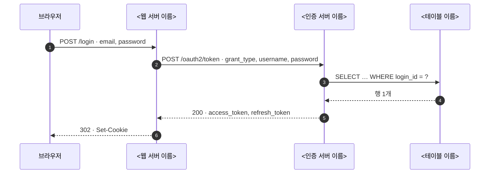

# 글 종류별 뼈대

원본의 순서와 목차는 따르지 않는다 (규칙 1-4). 원본이 이야기하는 주제에 맞는 글 종류를 고르고 그 순서대로 쓴다. 맞는 종류가 없으면 가장 가까운 것을 쓰고, 지금 상태(3-1)를 결정보다 앞에 두는 것만 지킨다.

| 종류 | 언제 | 순서 |
|---|---|---|
| 질문에 대한 답 | "왜", "어디", "어떻게" 같은 물음 | 첫 문장에 결론 → 근거 1~3줄 → 필요하면 예시 하나 |
| 개념 설명 | 재료 안에 나온 기술이나 동작 하나를 풀 때. 처음부터 배우려는 것이면 make-textbook | 한 줄 결론 → 용어 표 → 큰 그림 → 절마다 그림, 예시, 짧은 설명 → 되짚기 |
| 현황 조사 | 지금 코드나 시스템이 어떻게 되어 있는지 | 쓰는 기술 → 동작 방식 → 데이터가 어디에 어떤 모양으로 들어가는지 → 위험한 곳 → 어디부터 볼지 |
| 설계 | 무엇을 바꿀지 제안할 때 | 지금 상태(현황 조사로 링크하거나 요약) → 큰 그림(바뀐 뒤) → 바뀌는 것 전후 → 정할 것 |
| API 흐름 | 요청이 어떤 서버를 거치는지 | 참여자 표 → 시퀀스 다이어그램 한 장 → 단계 표 → 실제 요청과 응답 |
| 작업 보고·PR | 한 일을 알릴 때 | 무엇을 왜 → 전후 그림이나 diff → 바뀐 것(줄 맨 앞에 위치) → 봐 줄 곳 |
| 결정 요청 | 사용자가 골라야 할 때 | 항목마다 지금 상태 → 왜 정해야 하나 → 고르면 달라지는 것 → 추천과 이유 |
| 진행 상황 | 지금 어디까지 했는지 | 지금 하는 일 한 줄 → 남은 일 → 기다리는 것 |

## API 흐름

````markdown
이 글이 답할 질문: <한 문장>

| 참여자 | 종류 | 하는 일 |
|---|---|---|
| <앱 이름> | <웹 서버 / 인증 서버 / DB 테이블 …> | <한 줄> |



그림에 없는 것: <있을 것 같은데 없는 것과 이유>

| # | 부르는 쪽 → 받는 쪽 | API | 보내는 값 | 받는 값 | DB 읽기·쓰기 | 코드 위치 |
|---|---|---|---|---|---|---|

실제 요청과 응답:

```
curl -X POST … 
{ "access_token": "…", "expires_in": 300 }
```
````

## 작업 보고·PR

사람이 읽는 본문은 1,000자 안쪽으로 쓴다. 자세한 것은 `<details>` 접기에 둔다.

````markdown
## 무엇을 왜
<무엇이 문제였고 무엇을 바꿨는지 두세 문장. 지금 상태부터.>

## 바뀐 것
- `<파일 경로>` — <바뀐 것 한 줄>
- `<파일 경로>` — <바뀐 것 한 줄>

## 전후
<그림 두 장, 또는 원문과 수정본, 또는 diff>

## 봐 줄 곳
- <봐 줄 곳과 까닭을 문장으로>
````

## 결정 요청

항목마다 아래 네 칸을 채운다. 고르는 쪽이 셋을 넘으면 표로 바꾼다.

````markdown
### <결정할 것 한 줄>

- 지금 상태: <지금 어떻게 되어 있는지. 테이블 행이나 코드 위치>
- 왜 정해야 하나: <정하지 않으면 무엇이 막히는지>
- 고르면 달라지는 것:
  | 고르는 쪽 | 결과 (예시 데이터로) |
  |---|---|
- 추천: <하나와 이유>
````

## 개념 설명과 현황 조사

기반 지식을 처음부터 배우려는 것이면 make-textbook을 쓴다. 재료 안의 개념 하나나 지금 코드의 상태를 정리하는 것이면 위 표의 순서를 따르고, 절마다 "그림 → 표 → 짧은 설명" 순서로 쓴다. 글이 그림을 설명하고, 그림이 글을 꾸미지 않는다.
