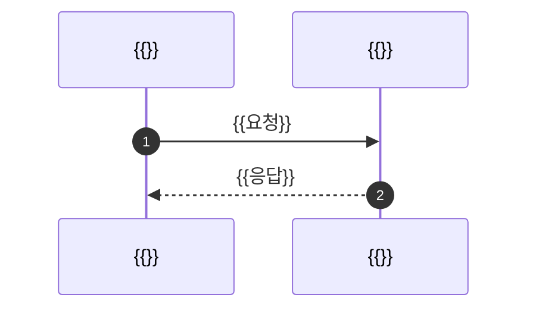

# {{N}}장 {{제목}}

이 장의 목적: {{무엇을 하기 위해}} 필요한 만큼만.

> [!abstract] 한 줄 결론
> {{이 장이 말하는 것 한 문장.}}

> [!info]- 이 장의 용어 (펼치기)
> | 용어 | 종류 | 뜻 | 예 |
> |---|---|---|---|
> | `{{}}` | 인터페이스 / 클래스 / 테이블 / JWT claim / … | {{}} | {{실제 값이나 코드 한 줄}} |

## 0. 큰 그림 하나

읽는 순서는 ① → ② → ③ 이다. ▶ 는 보내는 것, ◀ 는 받는 것이다.

```mermaid
flowchart LR
    A[{{주체}}] <-->|"① ▶ {{보내는 것}}<br/>◀ {{받는 것}}"| B[{{상대}}]
    classDef common fill:#dbeafe,stroke:#2563eb,color:#1e3a8a
    classDef domain fill:#fef3c7,stroke:#d97706,color:#78350f
    classDef bad fill:#fee2e2,stroke:#dc2626,color:#7f1d1d
    classDef good fill:#dcfce7,stroke:#16a34a,color:#14532d
```

> [!tip] 그림에서 바로 읽히는 것
> - {{한 줄}}
> - {{한 줄}}

---

## 1. {{절 제목}}



| {{칸}} | {{칸}} | {{칸}} |
|---|---|---|
| {{}} | {{}} | {{}} |

{{그림과 표가 말한 것을 두세 문장으로. 결론 먼저.}}

> [!note]- 더 보기
> {{목적에 꼭 필요하지 않은 세부.}}

---

## 현황

<!-- 프로젝트 기반 책일 때만 둔다. 일반 지식 책이면 이 절을 지운다. -->

지금 코드에서는 [[현황 {{주제}} (코드 기준)]] §{{n}} 을 본다. {{한 줄 요약, 파일:줄.}}

> [!summary] 되짚기
> - {{}}
> - {{}}
> - {{}}

## 지금 정할 것

| 결정 | 추천 | 이유 |
|---|---|---|
| {{}} | {{}} | {{}} |

## 근거

<!-- 사실 검토에서 확인한 공식 문서·규격 URL. 주장 한 줄 — URL -->
