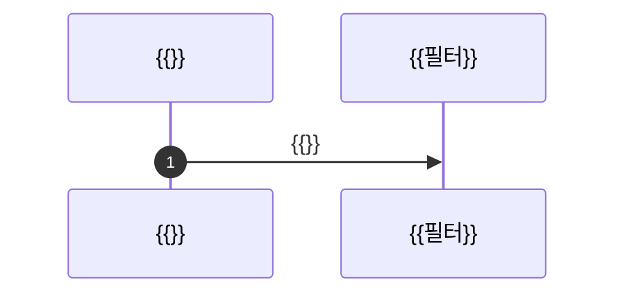

# 현황: {{주제}} (코드 기준)

> [!abstract] 한 줄 결론
> {{지금 어떻게 되어 있는지 한 문장.}}

> [!warning] 읽기 전에
> 코드를 읽어 적었고 실행해 보지는 않았다. 줄 번호는 기준 커밋 기준이다.

## 0. 한눈에

| 주체·앱 | {{무엇을}} | {{어떻게}} | {{근거}} | {{역할·범위}} |
|---|---|---|---|---|
| {{}} | {{}} | {{}} | {{}} | {{}} |

```mermaid
flowchart LR
    A[{{}}] -->|"{{}}"| B[{{}}]
```

## 1. {{앱 또는 주제}}

### 1-1. 설정과 체인
{{파일:줄, 무엇을 하나.}}

### 1-2. API 표
| 경로 | 요청 | 응답 | 파일:줄 |
|---|---|---|---|
| {{}} | {{}} | {{}} | {{}} |

### 1-3. 요청 때 판정 흐름


### 1-4. 데이터 모델
```mermaid
erDiagram
    {{TABLE}} {
        string id PK
    }
```

## 8. 위험

| # | 위험 | 어디 | 왜 |
|---|---|---|---|
| 1 | {{}} | {{파일:줄}} | {{}} |

## 9. 어디부터 볼지

| 알고 싶은 것 | 파일 |
|---|---|
| {{}} | `{{경로}}` |
